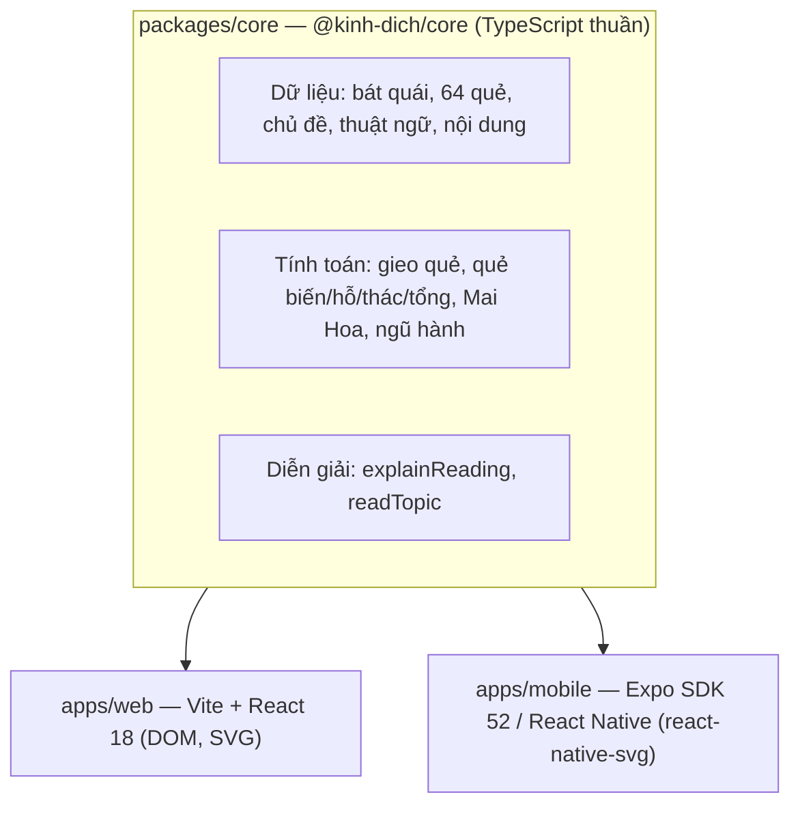
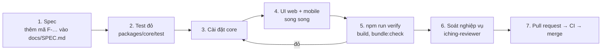
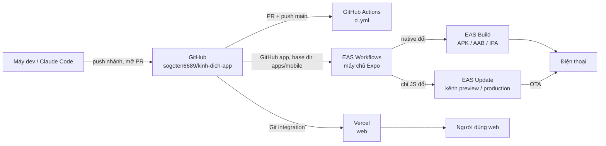
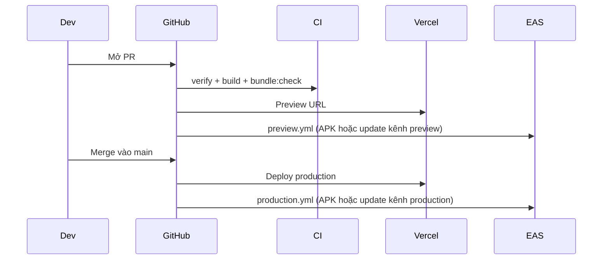

# Kinh Dịch App

Gieo quẻ và tra cứu Kinh Dịch bằng tiếng Việt: **web** (Vite + React, deploy Vercel) và **mobile** (Expo / React Native, build trên EAS), dùng chung lõi `@kinh-dich/core`.

Ứng dụng chính thức: **https://kinhdich-app.vercel.app** · Tải app Android (APK): **[link tải](https://0316888896-my.sharepoint.com/:u:/g/personal/lam_nguyen_egitech_vn/IQCKdy4mfH-rRahfrVvPH-XzAVTKsPP3IP2k9rFLE7pwVkw?e=EqrZfs)** · Tác giả: **Lam Nguyen — Egitech**.

Mã QR cài app Android có ở nút **"Tải app Android"** trên web và trong trang **Giới thiệu** (web và app).

## Tính năng

- **Gieo quẻ**: 3 đồng xu (gieo từng hào, đồng xu lật), cỏ thi (mô phỏng xác suất), Mai Hoa theo hai số (hiện từng bước chia lấy dư); ghi câu hỏi.
- **Lập quẻ**: quẻ chủ, hào động (○ ×), quẻ biến, hỗ quái, thác quái, tổng quái; tên hào truyền thống; quy tắc đọc theo số hào động (Chu Hy).
- **Giải thích 7 phần**: tình thế, cấu tạo quẻ và ngũ hành nội–ngoại, hào động và ý nghĩa vị trí, chiều hướng, diễn biến bên trong, góc nhìn khác, nên đọc lời nào.
- **Xem theo chủ đề**: Tình duyên, Công việc, Vận mệnh — mức Cát/Bình/Hung, chiều hướng, thay đổi đến từ đâu, lời khuyên.
- **Thể – Dụng** (Mai Hoa) trên vòng ngũ hành tương sinh – tương khắc.
- **Tra cứu**: 64 quẻ (bảng 6 hào, đắc chính / đắc trung, quẻ liên quan, lời theo chủ đề), bát quái Tiên Thiên / Hậu Thiên, thuật ngữ bấm để xem giải thích.

Tài liệu: [Đặc tả](docs/SPEC.md) · [Nghiệp vụ Kinh Dịch](docs/kinh-dich.md) · [Deploy chi tiết](docs/DEPLOY.md) · [Hướng dẫn cho Claude](CLAUDE.md)

## Chạy nhanh

```bash
npm install
npm run dev:web                        # web: http://localhost:5173
npm run dev:mobile                     # Expo dev server (dùng với development build)
npm run web -w @kinh-dich/mobile       # xem app mobile trên trình duyệt
npm run verify                         # typecheck + test toàn bộ
```

---

# Hệ thống được xây dựng như thế nào

## 1. Kiến trúc

Một **monorepo npm workspaces** gồm ba package. Toàn bộ logic và chữ hiển thị nằm ở lõi; hai app chỉ vẽ giao diện, nên web và mobile luôn có cùng tính năng và cùng nội dung.



| Thư mục | Vai trò |
|---|---|
| `packages/core/src` | `trigrams.ts`, `hexagrams.ts` (bảng Văn Vương), `casting.ts`, `reading.ts`, `meihua.ts`, `elements.ts`, `explain.ts`, `topics.ts`, `glossary.ts`, `content.ts` |
| `packages/core/test` | Vitest — mọi quy tắc nghiệp vụ có test với ví dụ tính tay, mang mã tính năng `F-…` |
| `apps/web/src` | Component React: `CastPanel`, `ReadingView`, `TopicCard`, `HexagramDetail`, `BaguaView`, `WuxingCycle`, `AboutView`… |
| `apps/mobile/src` | Màn hình React Native tương ứng 1–1 với web |
| `assets/brand/logo.svg` | Logo gốc; `scripts/gen-icons.mjs` sinh favicon, icon app, splash |
| `docs/` | Đặc tả, nghiệp vụ, deploy |
| `.claude/` | Harness cho Claude Code (xem mục 3) |

Nguyên tắc thiết kế:

- **Core không phụ thuộc UI**: không import React/DOM/RN; được dùng thẳng từ source (`main: src/index.ts`), không có bước build.
- **Hào đánh từ dưới lên** (index 0 = hào sơ); khi vẽ thì đảo ngược. Bit 1 = dương, 0 = âm; giá trị gieo 6/7/8/9.
- **Ngẫu nhiên tiêm được**: hàm gieo nhận `rng`; test dùng `seededRng(seed)` để tái lập.
- **Song song web ↔ mobile**: tính năng mới làm trên cả hai app trong cùng một thay đổi; cột Web/Mobile trong `docs/SPEC.md` phải khớp.

## 2. Quy trình làm một tính năng



Kiểm tra thủ công trước khi mở PR: chụp màn hình web (khổ 1100px và 390px) và app mobile qua Expo web để so hai nền tảng.

## 3. Harness Claude Code (`.claude/`)

Dự án được phát triển cùng Claude Code. Harness biến các quy tắc trên thành ràng buộc tự động:

| Thành phần | File | Làm gì |
|---|---|---|
| **Context** | `CLAUDE.md`, `docs/kinh-dich.md` | Nạp kiến trúc, quy tắc, kiến thức Kinh Dịch vào mọi phiên |
| **SessionStart** | `hooks/session-start.mjs` | Tự `npm install` nếu thiếu, báo nhánh và thay đổi chưa commit |
| **Chặn lệnh** (PreToolUse) | `hooks/guard-bash.mjs` | Chặn force-push, push lên `main`, `rm -rf` nguy hiểm, `reset --hard`, đọc `.env`, `--no-verify`, cập nhật snapshot để lách test |
| **Chặn sửa file** (PreToolUse) | `hooks/guard-files.mjs` | Không cho sửa `package-lock.json`, `.env`, cấu hình harness; không cho ghi đè file test làm giảm số test |
| **Test sau mỗi lần sửa** (PostToolUse) | `hooks/post-edit-check.mjs` | Typecheck workspace vừa sửa; sửa core thì chạy test core và typecheck cả web lẫn mobile |
| **Vòng lặp** (Stop) | `hooks/stop-verify.mjs` | Có thay đổi chưa commit mà `npm run verify` đỏ → không cho kết thúc, buộc sửa tiếp (tối đa 5 vòng) |
| **Skill** | `skills/feature-loop`, `skills/verify` | Quy trình TDD ở mục 2; chạy toàn bộ cổng kiểm tra |
| **Subagent** | `agents/iching-reviewer.md`, `agents/test-writer.md` | Soát đúng nghiệp vụ; viết test thất bại trước |
| **Quyền** | `settings.json` | Cho phép sẵn lệnh test/typecheck/git đọc; cấm đọc `.env`, force-push, `npm publish` |

---

# Hạ tầng

## 1. Tổng quan



| Dịch vụ | Dùng cho | Cấu hình trong repo | Kích hoạt |
|---|---|---|---|
| **GitHub Actions** | CI: typecheck, test, build web, bundle Android | `.github/workflows/ci.yml` | Mỗi PR và push `main` |
| **Vercel** | Host web (tĩnh) | `vercel.json` (Root Directory = gốc) hoặc `apps/web/vercel.json` (Root Directory = `apps/web`) | Git integration: preview mỗi PR, production khi merge `main` |
| **EAS Workflows** | Build/Update mobile trên máy chủ Expo | `apps/mobile/.eas/workflows/*.yml` | Kết nối GitHub trong expo.dev |
| **EAS Build** | Tạo file cài | `apps/mobile/eas.json` | Từ workflow hoặc `eas build` |
| **EAS Update** | Cập nhật qua mạng (OTA) | `runtimeVersion: fingerprint` trong `app.config.ts` | Từ workflow hoặc `eas update` |

Project Expo: **`@sogoten6689/kinh-dich-app`**, id `c946102a-7cad-4886-9743-b9c29f7048cb` (đã có trong `apps/mobile/app.config.ts`).

## 2. Web — Vercel

- Install chỉ cài phần cần cho web: `npm ci --workspace @kinh-dich/web --include-workspace-root` (không kéo Expo).
- Build `vite build` → `apps/web/dist`; mọi đường dẫn rewrite về `index.html`.
- Hai file `vercel.json` để Root Directory đặt kiểu nào cũng build được; `vercel.json` ưu tiên hơn cài đặt trên dashboard.
- Dự phòng: `.github/workflows/deploy-web.yml` deploy qua Vercel CLI khi có secret `VERCEL_TOKEN`, `VERCEL_ORG_ID`, `VERCEL_PROJECT_ID` (tự bỏ qua nếu chưa có).

## 3. Mobile — Expo EAS

### Build profile (`apps/mobile/eas.json`)

| Profile | Xuất ra | Phân phối | Kênh OTA | Dùng khi |
|---|---|---|---|---|
| `development` | APK/IPA có dev client | internal | `development` | Phát triển: app tải code từ `npx expo start` trên máy tính |
| `preview` | APK | internal | `preview` | Cài thử từ PR |
| `apk` | APK (cấu hình production) | internal | `production` | Bản dùng thật cài thẳng — workflow `main` build profile này |
| `production` | AAB | store | `production` | Nộp Google Play / App Store |

### EAS Workflows (`apps/mobile/.eas/workflows/`)

| File | Khi nào | Làm gì |
|---|---|---|
| `preview.yml` | PR vào `main` | Tính **fingerprint** phần native → đã có build cùng fingerprint thì `eas update` kênh `preview`, chưa có thì build APK `preview` |
| `production.yml` | Push / merge `main` | Như trên với profile `apk`, kênh `production` |
| `build-all.yml` | Chạy tay | Build `preview` cho Android và iOS |

`runtimeVersion` theo **fingerprint**: thêm thư viện native hay đổi cấu hình native thì fingerprint đổi → tự build bản mới; chỉ sửa JS/TS thì chỉ đẩy update. App đã cài nhận update ở lần mở thứ hai sau khi phát hành.

`.github/workflows/deploy-mobile.yml` là đường dự phòng chạy tay (cần secret `EXPO_TOKEN`).

### Thiết lập một lần

1. `npm install -g eas-cli`, rồi `cd apps/mobile && eas login && eas init --id c946102a-7cad-4886-9743-b9c29f7048cb`.
2. expo.dev → project → *Project settings* → *GitHub* → kết nối repo, **Base directory = `apps/mobile`**.
3. Build Android đầu tiên trên máy để EAS tạo keystore: `npm run eas:build:android:apk`.
4. iOS (cần Apple Developer): `eas build -p ios --profile preview`, đăng ký máy bằng `eas device:create`.

### Lệnh build từ gốc repo

```bash
npm run eas:build:android:apk        # APK dùng thật
npm run eas:build:android:preview    # APK cài thử
npm run eas:build:android:dev        # development build (cần npx expo start để chạy)
npm run eas:build:ios:dev
```

## 4. Luồng phát hành



## 5. Sự cố thường gặp

| Hiện tượng | Nguyên nhân | Cách xử lý |
|---|---|---|
| `Failed to read "/eas.json"` | Chạy `eas` ở gốc monorepo, hoặc Base directory trên expo.dev để trống | Chạy trong `apps/mobile` / dùng `npm run eas:build:…`; đặt Base directory = `apps/mobile` |
| `Failed to read "/mobile/package.json"` | Base directory đặt sai thành `mobile` | Đổi thành `apps/mobile` |
| Build dừng khi đọc cấu hình | `slug`/`owner` không khớp project trên expo.dev | `app.config.ts`: `slug: "kinh-dich-app"`, `owner: "sogoten6689"` |
| Mở app chỉ thấy "Development servers" | Đang dùng development build | Chạy `npx expo start` trong `apps/mobile` (cùng Wi-Fi) hoặc cài bản `apk` |
| Vercel `STATIC_BUILD_NO_OUT_DIR` | Root Directory = `apps/web` mà dashboard đặt output sai | Đã có `apps/web/vercel.json` ghi đè; kiểm tra Root Directory |
| App không nhận bản mới | Update chưa phát hành hoặc khác kênh | Kiểm tra expo.dev → Updates; tắt hẳn app và mở lại hai lần |
| Không biết đang chạy bản nào | — | Trang **Giới thiệu → Thông tin bản đang chạy**: kênh cập nhật, mã build, profile build, bản cập nhật |

Chi tiết từng bước: [docs/DEPLOY.md](docs/DEPLOY.md).
